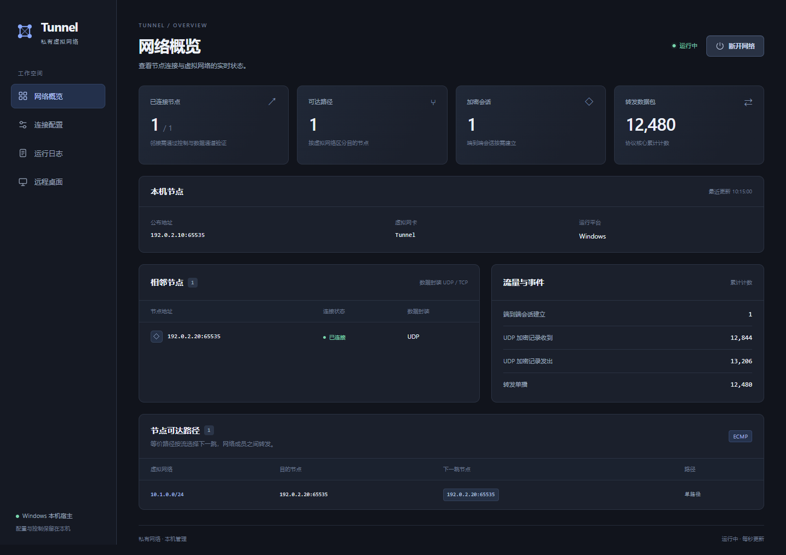

# Tunnel

一个跨平台三层加密组网工具，支持多跳转发、UDP/TCP 数据封装、图形界面与命令行管理，并提供 Linux 内核数据后端。

## UI 示例

以下为当前界面使用示例数据渲染的截图，展示连接状态、节点和流量统计。



查看 [完整 UI 使用示例](docs/ui-example.md)，包含配置、日志截图和两节点操作步骤。可导入 [节点 A](examples/ui-node-a.json) / [节点 B](examples/ui-node-b.json) 配置开始体验。

## 功能

- **虚拟网络**：IPv4/IPv6、单设备多地址、多个不重叠网段、按 peer 授权。
- **加密通信**：TLS 1.3 与每对 peer 的预共享密钥（PSK）认证；单播端到端 AES-256-GCM 加密，以及链路逐跳保护。
- **多跳与选路**：路径通告和撤回、按跳数 ECMP、单播按流选择下一跳、故障重连；广播/组播使用 RPF 检查和跳数限制。
- **传输选择**：默认 UDP，可按 peer 选择 TCP；TCP 数据复用已认证的 TLS 控制连接。
- **地址与内网**：可选独立地址分配服务、持久租约与离线回收；内网网段发布、主备出口及系统 SNAT。
- **管理**：配置、连接状态、日志界面；命令行编辑、运行状态查询与配置热加载。
- **远程桌面**：屏幕查看、键鼠操作、只读权限、设备授权、预授权无人值守和实时撤销。
- **Linux 内核后端**：自定义三层 `net_device`，UDP 数据封装、加解密与转发在内核完成；控制面及 TCP/TLS 通道保留用户态。

项目采用 C++11、libevent 和 OpenSSL 3.x。桌面界面使用 Python/pywebview，Android 宿主使用 WebView、VpnService 和 JNI。
## Layout and build

Directory layout is intentionally small: `src/` contains the cross-platform C++ core; `config/` contains the repository default configuration; `examples/` contains sample node profiles; `gui/`, `remote_desktop/`, `android/`, and `kernel/` contain platform or feature code; `tests/` contains automated tests; `tools/` contains development utilities; `third_party/` contains bundled runtime dependencies; `docs/` contains documentation; and `build/` contains generated files only.

On Windows, double-click `build.bat`. On Linux or macOS, run `./build.sh`. The script configures CMake and builds the core; run CTest separately when you want the test suite. Add `--gui` on Windows to package the desktop application under `build/gui/TunnelUI/`.

On Windows, double-click `run-gui.vbs` to start the packaged desktop UI without opening a console window. Use `run-gui.bat` from a terminal when you need to pass command-line options or start the source fallback. On Linux/macOS, use `./run-gui.sh`. Run the command-line manager with `run-cli.bat` or `./run-cli.sh`; arguments after the script are passed to the CLI, for example `./run-cli.sh status`.

The same entry point is available everywhere:

```bash
python3 scripts/build.py
python3 scripts/build.py --clean
```

Android continues to use Gradle from `android/`; the Linux kernel module continues to use `tools/build_kernel.py`. These platform builds keep their own outputs and do not reuse incompatible CMake caches.

## 平台与当前边界

| 平台 | 网络设备 | 验证状态 |
| --- | --- | --- |
| Linux / WSL | 默认 `kernel`，可显式选择 `/dev/net/tun` | 已完成真实网络、内核模块、TCP/UDP、路由与 SNAT 测试 |
| Windows | Wintun | 已完成与 Linux/WSL 的真实互通测试 |
| macOS | utun | 后端已编写，尚未在目标平台构建和实机验证 |
| Android | VpnService/TUN | 宿主及 JNI 工程已编写，尚未在目标平台构建和实机验证 |

远程桌面已验证 Windows 屏幕采集和 Linux X11 的端到端键鼠操作；macOS 后端待实测。需要已登录的图形会话，当前不支持 Wayland、登录/安全桌面或 Android 远控。直接启动 C++ 核心只建立隧道，远控需通过桌面界面或独立后台启动。

本项目面向互信节点组网：路径与公钥传播信任已接入节点如实转发。当前不提供 NAT 穿透、TAP/以太网桥接、重叠虚拟网段、动态 PMTU、隧道分片重组或默认路由接管。内网功能允许隧道节点发起连接及内网设备回包，暂不支持内网设备主动向隧道发起新连接。

## 从源码构建

需要 CMake 3.16+、C++11 编译器、OpenSSL 3.x 和 libevent core。在仓库根目录执行。Ubuntu/Debian 示例：

```bash
sudo apt-get update
sudo apt-get install -y build-essential cmake ninja-build libssl-dev libevent-dev \
    python3 iproute2 iputils-ping nftables

cmake -S . -B build -G Ninja -DCMAKE_BUILD_TYPE=Release
cmake --build build --parallel 2
ctest --test-dir build --output-on-failure
```

Windows 使用同一 CMake 工程，需安装与编译器 ABI 一致的 OpenSSL/libevent，必要时通过 `CMAKE_PREFIX_PATH`、`OPENSSL_ROOT_DIR` 指定依赖。运行时需要管理员权限，并将官方、架构匹配的 `wintun.dll` 放到核心程序旁。具体平台说明见 [开发说明](docs/development.md)；Android 构建入口见 [Android 文档](android/README.md)。

## 两节点快速开始

先生成一把 PSK，通过可信方式交给另一端；同一对 peer 使用相同密钥：

```bash
./build/tunnel --generate-key
```

以下地址为文档示例，必须替换成实际可达的公布 IP 和端口。`networks` 填写本机的虚拟 IP/前缀，两端属于同一虚拟网段但使用不同 IP。

节点 A 保存为 `node-a.json`：

```json
{
  "device_backend": "tun",
  "address": "192.0.2.10:65535",
  "networks": ["10.1.0.1/24"],
  "peers": [
    {
      "address": "192.0.2.20:65535",
      "shared_key": "REPLACE_WITH_THE_GENERATED_SHARED_KEY"
    }
  ]
}
```

节点 B 保存为 `node-b.json`：

```json
{
  "device_backend": "tun",
  "address": "192.0.2.20:65535",
  "networks": ["10.1.0.2/24"],
  "peers": [
    {
      "address": "192.0.2.10:65535",
      "shared_key": "REPLACE_WITH_THE_GENERATED_SHARED_KEY"
    }
  ]
}
```

分别校验并启动，B 端将文件名替换为 `node-b.json`：

```bash
./build/tunnel --check node-a.json
sudo ./build/tunnel node-a.json --watch-config
```

在 A 端执行 `ping 10.1.0.2` 检查连通性。Windows 在管理员终端中使用 `.\build\tunnel.exe`，多配置构建器的程序通常位于 `build\Release\`。

公布地址不是绑定通配地址；默认绑定同地址族的本地通配地址及相同端口。UDP 模式需要 TCP/UDP 端点均可达；使用 NAT 时自行配置端口映射。若选择 TCP，在 peer 对象中添加 `"transport": "tcp"`，两端版本均须支持；程序不自动从 UDP 回退到 TCP。多网络时还须明确填写每个 peer 允许使用的网段。

上述配置显式选择 `tun`，无需安装本项目的内核模块。省略 `device_backend` 时，**Linux 默认使用 `kernel`，其他平台（包括 Android）默认使用 `tun`**。

## Linux 内核设备

先安装与**正在运行的内核**匹配的开发头文件和构建工具，再在仓库根目录构建、安装模块：

```bash
python3 tools/build_kernel.py
sudo install -D -m 644 build/kernel/tunnel_kmod.ko \
    /lib/modules/$(uname -r)/extra/tunnel_kmod.ko
sudo depmod -a
sudo modprobe tunnel_kmod

sudo ./build/tunnel node-a.json --device-backend kernel
```

也可将配置改为 `"device_backend": "kernel"`，或移除该字段以使用 Linux 默认值。模块未安装/加载时会明确报错，不自动退回 TUN。内核更新后需重新构建；模块二进制不能跨内核版本通用。

WSL 也需要与其运行内核匹配的构建树，普通发行版头文件不能直接替代。已在 WSL `6.18.40.1-microsoft-standard-WSL2` 完成实际运行验证，其他版本以对应编译和测试结果为准。构建要求、ABI、WSL 和 BTF 处理见 [内核后端说明](kernel/README.md)。

## 图形界面、命令行与热加载

桌面管理工具需要 Python 3.10+ 及对应平台的 WebView 依赖。安装 Python 依赖后，显式指定刚构建的核心：

```bash
python3 -m venv --system-site-packages .venv
.venv/bin/python -m pip install -r gui/requirements.txt
.venv/bin/python gui/main.py --binary build/tunnel
```

Linux GTK/WebKit 后端通常需要系统 `gi` 包和 WebKit 运行库，安装步骤见 [GUI 文档](gui/README.md)。启动网络需要相应设备与路由管理权限；Linux/macOS 当前没有独立提权服务。

也可通过命令行后台管理同一配置：

```bash
.venv/bin/python -m tools.tunnel_cli --binary build/tunnel start --config node-a.json
.venv/bin/python -m tools.tunnel_cli --binary build/tunnel status
.venv/bin/python -m tools.tunnel_cli --binary build/tunnel config set /tun_mtu 1300
.venv/bin/python -m tools.tunnel_cli --binary build/tunnel stop
```

上述后台管理方式与直接运行核心二选一，避免重复启动同一节点。GUI/CLI 保存会校验并应用运行配置；直接运行核心使用 `--watch-config` 监视文件，Linux/macOS 也支持 `SIGHUP`。peer 变更只重连受影响邻接；地址、设备和网络等变更会重建资源及连接。详见 [命令行说明](docs/cli.md)。

## 示例与文档

| 内容 | 入口 |
| --- | --- |
| UI 使用示例 | [界面截图与操作步骤](docs/ui-example.md)、[节点 A](examples/ui-node-a.json)、[节点 B](examples/ui-node-b.json) |
| 基础配置 | [default.json](config/default.json) |
| TCP 数据封装 | [节点 A](examples/tcp-node-a.json)、[节点 B](examples/tcp-node-b.json) |
| 自动地址分配 | [服务端](examples/address-server.json)、[客户端](examples/address-client.json) |
| 内网路由与 SNAT | [出口节点](examples/subnet-gateway.json)、[访问节点](examples/subnet-client.json) |
| 远程桌面 | [被控端](examples/desktop-host.json)、[控制端](examples/desktop-client.json)、[使用说明](remote_desktop/README.md) |
| Design and implementation | [Design](docs/design.md), [Development](docs/development.md) |
| Verification | [Test results](docs/test-results.md), [Tests](tests/) |

示例中的地址和密钥均需替换。普通 CTest 不要求创建真实隧道设备；真实网络、内核模块和 SNAT 集成测试需要 Linux 管理权限，运行方式及已验证范围见开发说明和测试记录。
