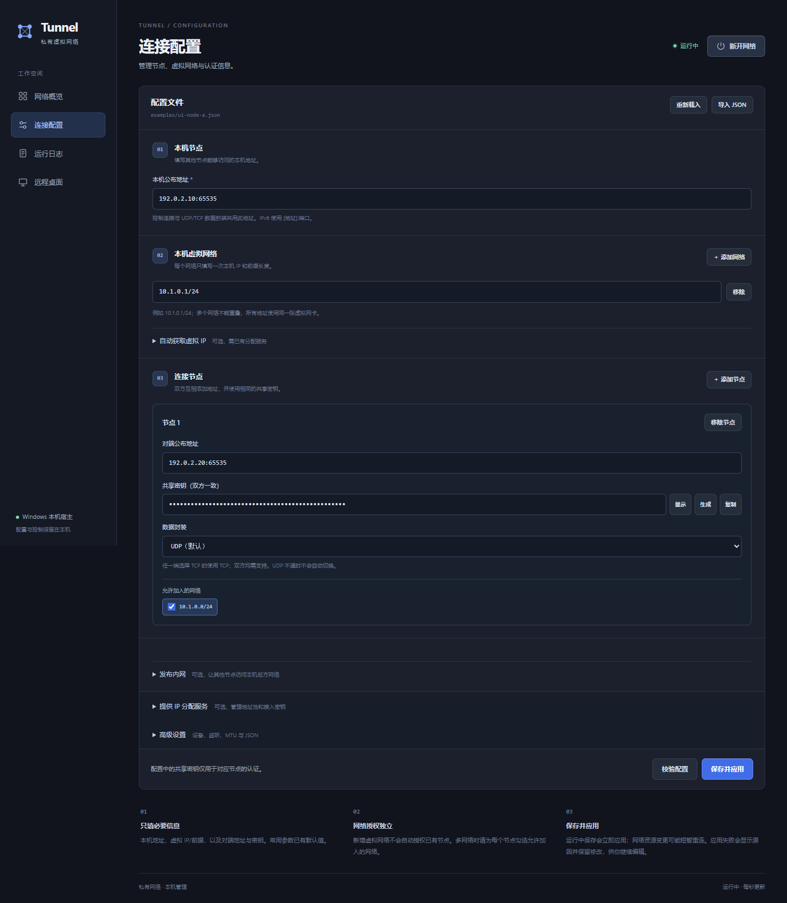
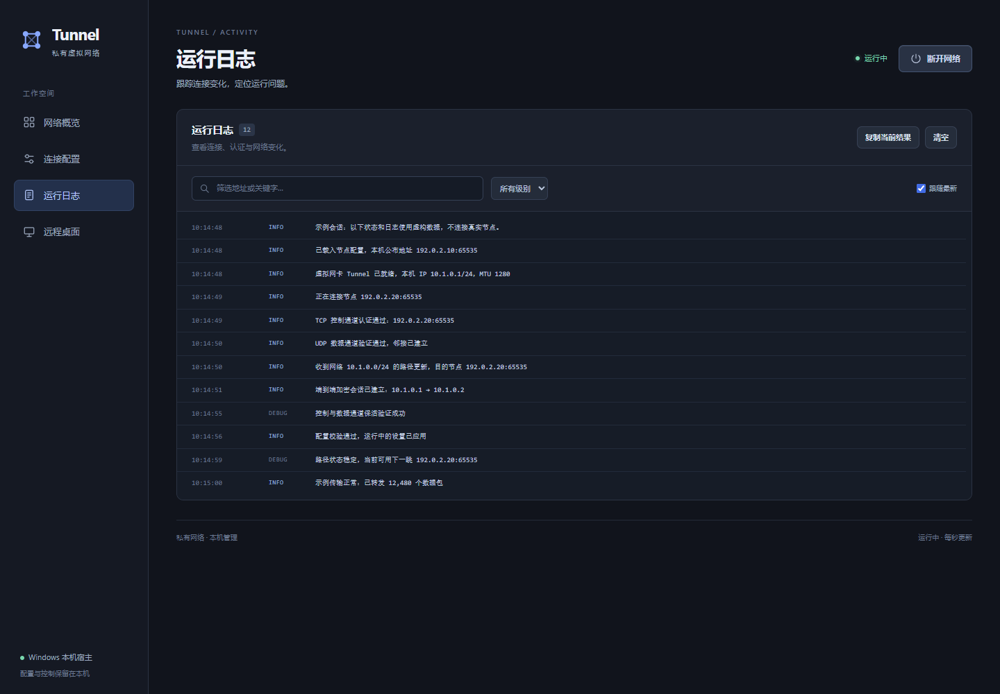

# UI 使用示例

本例演示两台设备通过界面配置并连接同一个虚拟网络。截图由当前项目的真实前端使用示例数据渲染，连接状态、日志和流量数字均用于展示，不代表已连接你的设备。

## 1. 打开界面

先按 [README](../README.md#从源码构建) 构建当前平台的核心，并按 [GUI 文档](../gui/README.md) 安装 Python 与 WebView 依赖。在仓库根目录运行：

```bash
python gui/main.py --binary build/tunnel --config-dir build/ui-example
```

Windows 使用：

```powershell
python gui/main.py --binary build/tunnel.exe --config-dir build/ui-example
```

将 `--binary` 改为实际构建的核心路径；例如多配置构建器通常输出到 `build/Release/tunnel.exe`。`build/ui-example` 是本例单独使用的配置目录，配置、身份和日志均保存在该目录中。

创建网络设备需要相应系统权限：Windows 使用管理员终端；Linux/macOS 需要具备配置设备与路由的权限。Linux 的桌面后端依赖及提权启动方式见 GUI 文档。

## 2. 导入并修改配置

在两台设备的“连接配置”页点击“导入 JSON”，分别选择 [ui-node-a.json](../examples/ui-node-a.json) 和 [ui-node-b.json](../examples/ui-node-b.json)。

| 配置项 | 节点 A | 节点 B |
| --- | --- | --- |
| 本机公布地址 | `192.0.2.10:65535` | `192.0.2.20:65535` |
| 本机虚拟 IP/前缀 | `10.1.0.1/24` | `10.1.0.2/24` |
| 对端地址 | `192.0.2.20:65535` | `192.0.2.10:65535` |
| 共享密钥 | 两端使用同一把随机密钥 | 与 A 相同 |
| 数据封装 | UDP | UDP |
| 隧道设备 | TUN | TUN |

`192.0.2.*` 是文档示例地址，连接前必须替换成双方实际可达的 IP 和端口。每端的本机公布地址和另一端填写的对端地址应对应。

在一端点击“生成”得到共享密钥，通过可信方式复制到另一端，再分别点击“校验配置”和“保存配置”（运行中显示为“保存并应用”）。不要在两端分别生成不同密钥。表单默认隐藏密钥。



本例显式选择 TUN，便于直接体验界面。Linux 若已安装并加载匹配的 `tunnel_kmod`，可在“高级设置 → 隧道设备”中选择“Linux 内核设备”；省略该配置时 Linux 默认使用内核设备。

UDP 模式需要双方 TCP/UDP 端点可达。需要 TCP 封装时，将节点卡片中的“数据封装”改为 TCP；两端程序均须支持此功能。

## 3. 连接并查看概览

两端点击“连接网络”，再打开“网络概览”，确认节点已连接、虚拟地址和路径正确。


顶部“运行中”表示本机核心已经启动，仍需通过邻居列表确认对端连接成功。连接后可在 A 端执行：

```bash
ping 10.1.0.2
```

在 B 端执行 `ping 10.1.0.1` 检查反向连通性。

## 4. 查看日志与修改配置

打开“运行日志”查看连接和运行事件，可按级别筛选、搜索或复制日志。



运行中在“连接配置”页修改并保存，会经过校验后热加载。peer 变更只重连受影响邻接；设备或虚拟网络变更会重建相应资源。结束体验时点击“断开网络”。

## 更新示例截图

截图使用真实 HTML/CSS/JS 和离线示例数据生成，不启动隧道。安装 Node.js 和 Playwright 后运行：

```bash
node tools/render_ui_examples.js
```

脚本优先使用已安装的 Chrome/Edge，也支持通过 `--browser` 指定浏览器、`--playwright` 指定已有 Playwright 包。详细参数以 `--help` 输出为准。
